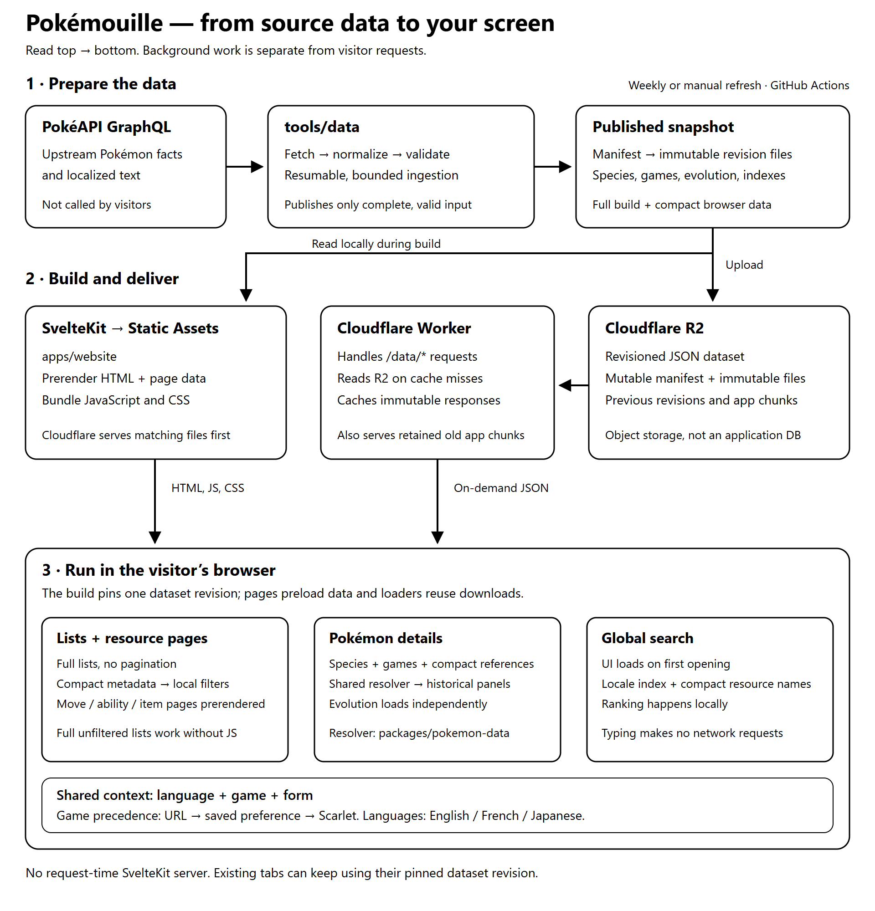

# Architecture

Pokémouille is a multilingual, game-aware Pokédex with **static page delivery and browser-side historical resolution**. Visitors do not call PokéAPI, and production does not run a SvelteKit application server.

[Editable SVG](architecture.svg) · [PNG preview](architecture.png) · [Setup and operating instructions](../README.md)

## Three separate lifecycles

1. **Refresh data in the background.** `tools/data` fetches PokéAPI GraphQL with resumable state and request limits, normalizes the results, and validates a complete snapshot before publication. The mutable `manifest.json` points to immutable files under `revisions/{datasetRevision}/`. Full references serve build-time consumers; compact projections serve browser features. An incomplete refresh does not replace the last-good publication.
2. **Build and deploy the site.** SvelteKit reads the published snapshot from `apps/website/static/data` and prerenders HTML, page data and revision-pinned learner/breeding JSON into `apps/website/build`; the build compiles that snapshot's `datasetRevision` into the app. Cloudflare Static Assets receives pages and app code; R2 receives the dataset, derived JSON and retained immutable app chunks. A normal deployment reuses published data rather than refreshing PokéAPI. CI republishes compatible dataset projections offline, builds, uploads immutable files before the manifest, and deploys the Worker last.
3. **Browse without an application server.** Matching static assets are served before the Worker runs. Unmatched dataset, derived JSON and retained app-chunk requests reach the Worker, which checks the edge cache where applicable and reads R2 on a miss. The browser downloads only the runtime data needed for the active feature, from the revision built into the page, and computes game-specific views locally.

A SvelteKit `+page.server.ts` loader in this project runs **during prerendering**, not as a request-time production API. Local development still uses the SvelteKit development server.

## Source map: where changes belong

Paths below are relative to the repository root.

| Boundary                      | Responsibility and starting points                                                                                                                                                                                                                                                                                                                                                                                                                                                                                                                                                                                                        |
| ----------------------------- | ----------------------------------------------------------------------------------------------------------------------------------------------------------------------------------------------------------------------------------------------------------------------------------------------------------------------------------------------------------------------------------------------------------------------------------------------------------------------------------------------------------------------------------------------------------------------------------------------------------------------------------------- |
| Ingestion and publication     | [`tools/data/src/client.ts`](../tools/data/src/client.ts) controls upstream requests; [`mapping.ts`](../tools/data/src/mapping.ts) normalizes source records; [`publish.ts`](../tools/data/src/publish.ts) publishes validated, revisioned assets and compact projections. `.data/state` holds resumable ingestion state, not visitor data.                                                                                                                                                                                                                                                                                               |
| Shared domain rules           | [`packages/pokemon-data/src`](../packages/pokemon-data/src) owns dataset types, validation, localization, game mappings, search-index construction, and historical Pokémon resolution. [`resolve.ts`](../packages/pokemon-data/src/resolve.ts) is the rules engine used by the browser; it has no Cloudflare or UI dependency.                                                                                                                                                                                                                                                                                                            |
| Static page generation        | [`server/snapshot.ts`](../apps/website/src/lib/server/snapshot.ts) shares revision-aware in-flight caches and bounded species reads across [`catalogue.ts`](../apps/website/src/lib/server/catalogue.ts), [`breeding.ts`](../apps/website/src/lib/server/breeding.ts), and [`locations.ts`](../apps/website/src/lib/server/locations.ts). They retain compact projections, not full species records. [`routes/[lang]`](../apps/website/src/routes/%5Blang%5D) supplies localized pages; [`routes/learners`](../apps/website/src/routes/learners) and [`routes/breeding`](../apps/website/src/routes/breeding) prerender derived JSON.     |
| Browser state and interaction | [`data/dataset.ts`](../apps/website/src/lib/data/dataset.ts) maps file names to the built revision; [`data/loader.ts`](../apps/website/src/lib/data/loader.ts) deduplicates fetches; [`hooks.server.ts`](../apps/website/src/hooks.server.ts) adds preload hints to prerendered pages; [`data/context.ts`](../apps/website/src/lib/data/context.ts) selects URL/preference context; [`data/pokemon.ts`](../apps/website/src/lib/data/pokemon.ts) separates downloads from resolution. [`components`](../apps/website/src/lib/components) renders the views, and [`search/rank.ts`](../apps/website/src/lib/search/rank.ts) ranks locally. |
| Delivery and deployment       | [`worker/index.ts`](../apps/website/worker/index.ts) serves R2-backed requests and cache headers; [`scripts/r2.ts`](../apps/website/scripts/r2.ts) transfers and retains assets; [`wrangler.jsonc`](../apps/website/wrangler.jsonc) binds Static Assets and R2; [the deploy workflow](../.github/workflows/deploy.yml) orders refresh, build, sync, and deployment.                                                                                                                                                                                                                                                                       |

Shared presentation lives in [`apps/website/src/app.css`](../apps/website/src/app.css). Link colors, visited states, underlines, and hover/focus emphasis are defined there so prose, catalogues, and detail pages stay consistent. Header navigation uses neutral text with underline emphasis for the current section; component styles retain their own layout and type-badge appearance.

## Runtime contracts

1. **One build-time revision.** The build compiles the local manifest's `datasetRevision` into the app, and the browser derives revision paths from shared file names ([`paths.ts`](../packages/pokemon-data/src/paths.ts)) without requesting `manifest.json`. Prerendered page data and runtime downloads therefore come from the same snapshot, and an open tab keeps its revision until it loads new HTML. Concurrent reads share promises, bounded caches reuse results, and failed loads are evicted so data retries can fetch again. The mutable manifest remains the publication pointer for builds and older tabs; immutable revision files can be cached long-term.
2. **Context before mechanics, not before downloads.** Language comes from the route; game precedence is URL → saved preference → Scarlet; form comes from the URL. Prerendered localized pages preload `games.json`; Pokémon pages also preload their species file, compact detail references and evolution chain, whose ID comes from page data. A small head script preloads the dataset-backed default artwork at high priority before hydration, but skips explicit form selections and saved non-default sprite preferences to avoid downloading the wrong image. Blocked preference storage follows the default-artwork behavior. The route's browser `load` starts the same data downloads, so a hovered Pokémon link warms them before navigation. Once context is ready, the shared resolver selects the historical fields. Evolution has independent loading/error/retry state, so it cannot block the overview. Late results from a previous species are ignored.
3. **Different features consume different projections.** Pokémon details load species plus compact detail references; global search combines a locale-specific Pokémon/form index with compact move/ability/item names; type matchups receive their type-name list in prerendered page data. The full `references.json` remains available for build-time consumers but is not the shared browser dependency. See the [published asset contract](../README.md#published-files).
4. **Lists and search stay local after loading.** Lists render the complete catalogue without pagination and retain compact metadata for local filtering. Full unfiltered lists are available without JavaScript; filters require JavaScript. Search UI and result/icon code load on first opening, then ranking makes no per-keystroke requests. A failed code import offers a page reload; failed data downloads retry in place.
5. **Missing knowledge is not a modern-data fallback.** Historical fields resolve by their actual generation, version group, or version semantics. Unsupported facts and distinct missing states remain explicit. Language fallback does not substitute another game's text. Preserve the [product rules](../README.md#product-rules) when changing projections or resolution.

There is no visitor account database or request-time GraphQL proxy. R2 is object storage; game, sprite and theme preferences live in the browser. Older dataset revisions, app chunks and derived learner/breeding JSON are retained so existing tabs can continue using their pinned files. No accounts, favorites, team building or collection tracking are implemented. Offline installation/PWA remains a later, **not started** [open item](../README.md#open-items).

## Feature projections and source evidence

Schema **3** retains the earlier mechanics/machine/encounter evidence and adds species egg groups/regional dex numbers, variety cry URLs, location regions and reference egg-group/dex/region mappings. All exploration features support English, French and Japanese; route/query contracts and detailed caveats are in the [README feature guide](../README.md#historical-detail-and-exploration-tools) and [homepage filter contract](../README.md#website).

- **Learnsets and move catalogue:** exact-group learnsets join compact move references for current category, power, accuracy, PP and priority, with mastery retained from learnset rows. These columns are labeled current, not historical mechanics. The move catalogue projects current stats for local name/type/category filtering and URL-backed `sort=name|power|accuracy|pp`; numeric sorts descend and missing/flexible values stay last.
- **Item evolution uses:** a revision-aware, bounded build-time species pass in [`server/item-evolutions.ts`](../apps/website/src/lib/server/item-evolutions.ts) indexes evolution-item and held-item references. It preserves complete matching methods, conjunctive conditions, alternatives, source/default provenance and required/resulting form identities, plus ancestor context. Selected-game applicability remains unresolved; it is not inferred from the item's prose or a method's introduction group.
- **TM/TR navigation:** reference `machines` records connect items and moves by exact version group. Move pages link matching machine items; item pages project only exact-group machine-method learners. Species/form introduction chronology removes later introductions; unknown chronology is a source gap, not unavailability. Mappings are never carried forward to other groups, and machine art alone supplies no mapping evidence.
- **Structured move properties:** full references supply current targets, flags, signed stat-stage changes and effect metadata to prerendered move pages. Drain is signed percent of damage dealt (positive recovery, negative recoil); the separate signed healing field uses the user's maximum HP (positive recovery, negative HP cost displayed as a positive magnitude). Critical-hit modifiers are stages rather than probabilities. Source-zero chances remain distinct from missing values and may mean conditional/unspecified. Missing flags do not establish impossible interactions. These facts do not reconstruct historical rules.
- **Pokédex text and Pokémon history:** [`data/pokemon-history.ts`](../apps/website/src/lib/data/pokemon-history.ts) groups only identical exact-version source texts (with marked per-version language fallback) in release chronology. The detail page also resolves the selected variety/form through the shared `resolvePokemon` engine for each generation, retaining sparse history bounds, explicit unknown ranges, empty ability slots and Generation I's single Special stat. Generation-based timelines do not establish special-game mechanics or obtainability, and missing history is not evidence that nothing changed. The comparison link preserves the selected species/form and exact game in its URL.
- **Encounter locations:** species files contain exact-version, variety-level encounters; compact references contain exact-version global `encounterCoverage`. The browser groups rows by location/area/method without borrowing records across versions or varieties. Slot rarity is not an overall rate and is never summed; source-default condition flags do not mean unconditional encounters. Cosmetic-form specificity, unknown chronology, unknown coverage, globally empty games and variety-level missing rows remain explicit. Gifts, trades, transfers and obtainability are not inferred.

Encounter `versionId` is authoritative for exact-game selection. Slot `versionGroupId` is provenance and can differ when the source reuses a slot across groups; normalization preserves it without treating it as encounter applicability.

[`PokemonReferences`](../packages/pokemon-data/src/types.ts) retains richer move columns, machine mappings and encounter coverage without adding full move prose to the Pokémon browser dependency. Full battle properties remain in `references.json`; encounter rows remain with their species. Search keeps its smaller names/identities projection.

- **Home and regional dexes:** [`home-filters.ts`](../apps/website/src/lib/data/home-filters.ts) combines current default-variety stats/types/abilities and species classifications with URL-backed table/list filters and sorting. [`regional-dex.ts`](../apps/website/src/lib/data/regional-dex.ts) requires explicit exact-version-group dex mappings, including DLC dexes; source membership/numbering is not availability.
- **Calculated figures and comparison:** [`stat-formulas.ts`](../apps/website/src/lib/data/stat-formulas.ts) computes supported Level 50/100 ranges from historically resolved base stats and states capture/hatch assumptions; current capture/hatch scalars have no historical bounds. [`compare.ts`](../apps/website/src/lib/data/compare.ts) owns up-to-six repeated `p=species~form` URL identities, while the compare route resolves each selected game/form with the shared engine. Neither feature invents special-game mechanics or missing history.
- **Breeding:** [`server/breeding.ts`](../apps/website/src/lib/server/breeding.ts) builds egg-group membership and per-species donor projections; [`data/breeding.ts`](../apps/website/src/lib/data/breeding.ts) applies exact-group learning, sex/group compatibility and introduction chronology. Direct acquisition and unresolved egg-only chains remain separate; Scarlet/Violet Mirror Herb transfer is not parent breeding. Current group/sex facts have historical gaps and variety-level learning does not establish cosmetic-form inheritance.
- **Moveset and breeding payloads:** the build emits `/learners/<revision>/<move>.json` and `/breeding/<revision>/<species>.json`, lazily fetched by the browser. They are **not dataset manifest assets** and dataset `republish` does not produce them. [`data/moveset.ts`](../apps/website/src/lib/data/moveset.ts) intersects up to four moves' exact-group variety learners; this does not prove simultaneous legality. [`derived-assets.ts`](../apps/website/derived-assets.ts), the R2 sync script and Worker share the accepted immutable URL boundary. Sync retains these build outputs alongside old app chunks for open tabs; they use the same long-lived immutable/edge-cache contract as revisioned data.
- **Location reverse lists:** [`server/locations.ts`](../apps/website/src/lib/server/locations.ts) projects compact region-grouped catalogues and per-location exact-version encounters. Browser selection never substitutes another version's rows, and the same slot-rate/condition/form caveats apply as on Pokémon details.
- **Coverage:** [`type-coverage.ts`](../apps/website/src/lib/data/type-coverage.ts) uses repeated `attack` query values, the historical matchup chart and compact historical type members for offensive coverage and single/dual-defender charts. Source-existing combinations and theoretical pairs remain distinct; abilities, move effects and obtainability are outside this model.
- **Preferences and media:** [`ThemeSelector.svelte`](../apps/website/src/lib/components/ThemeSelector.svelte) persists automatic/light/dark preference, applied before first paint by `app.html`. [`Cries.svelte`](../apps/website/src/lib/components/pokemon/Cries.svelte) attaches audio only on explicit Play and releases it on source/identity changes. Current/legacy variety recordings are not selected-game or cosmetic-form attribution.

Ingestion remains **GraphQL-only**. Common encounter lookup tables are fetched once with independent bounded-row/name counts; species pages carry scalar foreign keys and counted condition mappings, which normalization joins into the same published DTOs. At 1,025 species and 25 per page, a complete refresh requires 45 requests: 41 species pages, references, encounter lookups and two census checks. Existing durable rolling-hour limits, failed-attempt accounting and persisted cooldowns still apply.

**Operational cutover:** schema-2 and older publications cannot be upgraded offline to schema 3. A fresh schema-3 ingestion has completed locally; an externally published compatible dataset must still exist before deploying this website. Ordinary CI `data-pull` plus `republish` cannot upgrade a remote schema-2 dataset. For migration, fetch fresh source responses with `refresh --fresh` once, retain state/rate ledger/cooldown, then resume without `--fresh` until validated publication. Offline `republish` only rebuilds dataset projections from already compatible input. See the [migration and operating instructions](../README.md#generate-the-real-dataset).

## Keeping this guide and the diagram aligned

- Treat [architecture.svg](architecture.svg) as the editable diagram source and [architecture.png](architecture.png) as its generated preview. Update this guide and both assets when ownership, data flow, or delivery boundaries change; ordinary component or styling changes do not require a diagram edit.
- The SVG has a `960 × 1000` coordinate system, real text, accessible title/description, and no external resources. Theme colors have standalone fallbacks. The PNG is a high-resolution, opaque light-background rendering for viewers that cannot interpret SVG or theme variables.
- To regenerate the PNG, render the SVG in Chromium at exactly `960 × 1000` CSS pixels with a light page canvas, then capture only the SVG at 2× scale (`1920 × 2000` pixels). Keep rendering tooling temporary unless the repository later needs a maintained documentation build.
- Before saving a new preview, check every text element fits its box and the canvas, inspect arrow/heading intersections, and view the PNG itself. Keep source links above valid. No app rebuild is needed for a documentation-only update.

For commands, refresh recovery, data-file schemas, and Cloudflare setup, use the [README](../README.md) rather than duplicating those operating procedures here.
